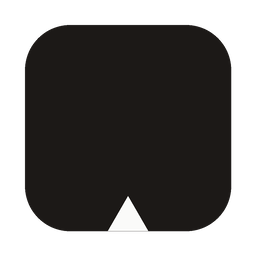
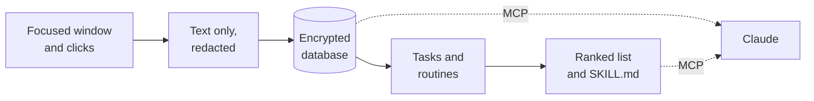

<p align="center">
  
</p>

<h1 align="center">Sextant</h1>

<p align="center">
  <b>Find the work worth automating.</b><br>
  A text-only record of your Mac work, with no screenshots, no audio and no telemetry.
</p>

<p align="center">
  <a href="https://github.com/Joelheile/sextant/releases/latest"></a>
  <a href="LICENSE"></a>
  
</p>

You repeat the same steps every week, and you can't see where the hours go. Sextant runs in your menu bar, keeps a private record of how you work, and shows you which routines to hand to an agent. Each one comes with a skill file that Claude can run.

It's for anyone who works on a Mac: developers, ops people, founders, consultants, assistants.

<p align="center">
  
</p>

## Install

```sh
curl -fsSL https://github.com/Joelheile/sextant/releases/latest/download/install.sh | sh
```

Or download [`Sextant.dmg`](https://github.com/Joelheile/sextant/releases/latest) and drag the app to `/Applications`. You need a Mac with Apple silicon and macOS 26 or later. The app is about 17 MB.

The script checks the disk image against the SHA-256 published with the release before it installs anything.

## What it does

- **Shows where your time goes.** Sextant groups what you do into tasks across apps and days, like "invoices: Mail, then Excel, then lexoffice".
- **Finds your routines.** Tasks you repeat become routines with their steps, how often you run them and the hours they take.
- **Ranks what to automate.** Each routine gets a score from the hours it takes and how much of it an agent could do, such as values you copy by hand between apps.
- **Writes the skill.** Every routine becomes a `SKILL.md` with its steps, example cases and rules, ready for Claude.
- **Makes your work searchable by your agent.** Ask it "Find the invoice number I saw yesterday" or "What did Anna say about pricing on Tuesday?"

## Set it up

Sextant runs in the menu bar. You control it from the terminal with the `sextant` command; the installer links it into `/usr/local/bin` when it can.

```sh
sextant setup      # grant access and start capture
sextant connect    # add Sextant to Claude Desktop and print the Claude Code command
sextant tui        # status, routines, your agent, privacy and the sent log on one screen
sextant help       # every command
```

"Open Sextant" in the menu bar menu opens `sextant tui` in Terminal. Sextant starts at login and restarts after a crash; Quit keeps it off until the next login.

## Use it with Claude

`sextant connect` adds Sextant to Claude Desktop. For Claude Code, run:

```sh
claude mcp add sextant -- /Applications/Sextant.app/Contents/MacOS/sextant mcp
```

Then ask Claude:

- "What should I automate first?"
- "How did I spend last week?"
- "Write a skill for my invoice routine."

## Privacy at a glance

- **Stored:** text only. App and window names, URLs, text on screen, buttons you click, what you leave in text fields, and meeting transcripts.
- **Never stored:** pixels, audio, keystrokes or passwords. Password managers, messengers and private browser windows are skipped by default.
- **Redacted before storage:** emails, IBANs, card numbers, API keys and tokens.
- **Where it lives:** one encrypted database on your Mac. The key is in your Keychain.
- **Network:** none, except the optional speech model download you start yourself. There is no telemetry, analytics, crash reporter or auto-updater. A CI check fails the build if network code appears outside one file.
- **Agents:** your data stays on your Mac until you ask an agent to read it. What the agent reads goes to wherever its model runs.

Read the details in [docs/PRIVACY.md](docs/PRIVACY.md).

## How it works



1. Sextant reads the focused window through macOS Accessibility, and falls back to on-device text recognition when an app exposes no text.
2. It redacts the text and stores it in an encrypted SQLite database.
3. It groups activity into tasks and finds the tasks you repeat.
4. It scores each routine and writes a skill file for it.
5. Claude reads all of this through a local MCP server, `sextant mcp`, which Claude starts when it needs it.

## FAQ

**Does Sextant record my keystrokes?**
No. It notes which labelled button you clicked and the text left in a field when you move on. It never reads password fields.

**Who can read my data?**
Only you, on your Mac. The database is encrypted and nothing is uploaded. An agent sees the data only when you connect it and it calls Sextant.

**Why macOS 26?**
Sextant is built and tested on macOS 26. It no longer uses Apple's on-device model, so a lower minimum may follow once it is tested.

**How do I delete everything?**
Run `sextant privacy delete-everything`. You can also choose how long raw data stays with `sextant privacy keep 30`, `90`, `365` or `forever`.

**Can Sextant transcribe calls?**
Yes, with the optional speech models (about 670 MB, downloaded only after `sextant audio on` asks and you agree). Sextant listens only while a call app or a browser has the microphone open, and keeps the transcript as text, never the audio. Call audio follows the same rules as screen capture: it does not start for an excluded app (Apple Passwords is excluded by default) or a private browser window. "Stop audio" in the menu bar menu ends it at once, and pausing capture ends it too. Transcribing people without consent is a crime in some countries, including Germany. Tell the other side first.

## Contributing

Bug reports and pull requests are welcome. See [CONTRIBUTING.md](CONTRIBUTING.md) to build from source and run the checks.

## License

Sextant is MIT licensed. See [LICENSE](LICENSE).

- **Parakeet TDT 0.6B v3** by NVIDIA, [CC-BY-4.0](https://creativecommons.org/licenses/by/4.0/), used as the ONNX export by istupakov. NVIDIA is the credited author.
- **Silero VAD** by the Silero team, MIT.
- **ONNX Runtime** by Microsoft, MIT, bundled in the app.
- The Rust dependencies keep their own licenses.
