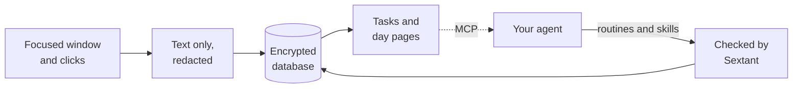

<p align="center">
  
</p>

<h1 align="center">Sextant</h1>

<p align="center">
  <b>Find the work worth handing to your AI agent.</b><br>
  A private, text-only record of how you work on your Mac. No screenshots, no audio, no telemetry.
</p>

<p align="center">
  <a href="https://github.com/Joelheile/sextant/releases/latest"></a>
  <a href="LICENSE"></a>
  
</p>

Agents like Claude Code and Codex can take over much of the repeated work you do at a computer. The hard part is knowing what to hand over and explaining how you do it. Sextant sits in your menu bar, records how you work as text, and lets your agent find your routines, measure the hours they take and write a skill it can run.

<p align="center">
  
</p>

## What you get

- **Where your time goes.** Day and week pages grouped by task, such as "invoice 4711 for Acme", not by app.
- **Your routines, with their hours.** Your agent reads those pages and saves the tasks you repeat as routines. Sextant checks every task it cites and computes the hours a week.
- **A skill for each routine.** Your agent writes a `SKILL.md` that Claude or Codex can run. Every step cites what Sextant saw you do.
- **Search over your past work.** Ask your agent "Find the invoice number I saw yesterday" or "What did Anna say about pricing on Tuesday?"

## Requirements

- A Mac with Apple silicon and macOS 26 or later.
- An agent to read the data: Claude Desktop, Claude Code or Codex.

## Install

Run this in Terminal:

```sh
curl -fsSL https://github.com/Joelheile/sextant/releases/latest/download/install.sh | sh
```

The script:

1. Downloads `Sextant.dmg` from the latest release and checks it against the SHA-256 published with it.
2. Checks that the app is signed and notarized by Apple.
3. Copies `Sextant.app` into `/Applications`. If Sextant is already running, it stops it first.
4. Links the `sextant` command into `/usr/local/bin` when that folder is writable. If it isn't, the script prints the `sudo ln` command to run.
5. Opens Sextant.

If you can't write to `/Applications`, install into your own folder:

```sh
curl -fsSL https://github.com/Joelheile/sextant/releases/latest/download/install.sh | SEXTANT_INSTALL_DIR=~/Applications sh
```

You can also download [`Sextant.dmg`](https://github.com/Joelheile/sextant/releases/latest) and drag the app to `/Applications`. The app is about 17 MB.

## Get started

1. **Grant access.** On first launch, the Sextant panel opens under the menu bar icon and shows how Sextant works. Click Set up, then Allow next to Screen Recording, Accessibility and Automation, one at a time, then Start capture.
2. **Connect your agent.** Run `sextant connect` for Claude Desktop, or see the next section for Claude Code and Codex.
3. **Work as usual for a few days.** Sextant needs to see a task more than once before it counts as a routine.
4. **Ask your agent:**
   - "What should I automate first?"
   - "How did I spend last week?"
   - "Write a skill for my invoice routine."

Sextant starts at login and restarts after a crash. Quit in the menu bar menu keeps it off until you open it again or log in again. It updates itself from GitHub releases once a day.

## Connect your agent

| Agent          | How to connect                                                                   |
| -------------- | -------------------------------------------------------------------------------- |
| Claude Desktop | `sextant connect` adds Sextant to its config. Restart Claude Desktop.            |
| Claude Code    | `claude mcp add sextant -- /Applications/Sextant.app/Contents/MacOS/sextant mcp` |
| Codex          | `sextant agent use codex`, then `sextant agent run`. Sextant runs Codex for you. |

Your agent reads Sextant through `sextant mcp`, a local MCP server it starts when it needs it. If you installed into `~/Applications`, use that path in the Claude Code command.

`sextant agent use claude` or `sextant agent use codex` lets Sextant run your agent itself, in a locked-down mode where its only tools are Sextant's. Add `--weekly` to have it look for new routines once a week.

## Everyday commands

| Command                    | What it does                                                         |
| -------------------------- | -------------------------------------------------------------------- |
| `sextant status`           | What Sextant captures right now                                      |
| `sextant tui`              | Status, routines, your agent, privacy and the sent log on one screen |
| `sextant pause` / `resume` | Pause capture for an hour, or resume it                              |
| `sextant routines`         | The routines your agent saved, with their hours a week               |
| `sextant sent`             | Every answer an agent got from Sextant, newest first                 |
| `sextant privacy`          | What is captured, what agents can read, how long data stays          |
| `sextant audio on`         | Transcribe calls. The first time downloads the speech models         |
| `sextant help`             | Every command                                                        |

Click the menu bar icon, or open Sextant.app again, to see the panel.

## Updates

Sextant updates itself. The installed app checks GitHub for a new release at start and then once a day. When there is one, it downloads it, checks its signature against the key built into the app, replaces itself and opens again. Your permissions stay granted, because every release is signed by the same developer.

To update by hand, run the install command again.

## Privacy at a glance

- **Stored:** text only. App and window names, URLs, text on screen, buttons you click, what you leave in text fields, and call transcripts if you turn them on.
- **Never stored:** pixels, audio, keystrokes or passwords. Password managers, messengers, private browser windows, and bank and payment sites are skipped by default.
- **Redacted before storage:** emails, IBANs, card numbers, API keys and tokens.
- **Where it lives:** one encrypted database on your Mac. The key is in your Keychain.
- **Network:** the speech model download, only if you start it, and the daily update check. There is no telemetry, analytics or crash reporter, and a CI check fails the build if network code appears anywhere else.
- **Agents:** your data stays on your Mac until your agent reads it. What it reads goes to wherever its model runs. `sextant sent` lists each answer it got.

Read the details in [docs/PRIVACY.md](docs/PRIVACY.md).

## How it works



1. Sextant reads the focused window through macOS Accessibility. When an app exposes no text, it falls back to Apple's on-device text recognition.
2. It redacts the text and stores it in an encrypted SQLite database.
3. Code groups your activity into tasks, joined by shared values such as an invoice number or an email address, and compiles day and week pages.
4. Your agent reads those pages through MCP, proposes routines and writes skills. Sextant rejects any claim that cites a task it never saw.

## Uninstall

Run `sextant uninstall`. It deletes all captured data, removes Sextant from Claude Desktop and moves the app to the Trash. To keep the app but delete the data, run `sextant privacy delete-everything`.

## Troubleshooting

- **The menu bar icon shows "!".** Capture stopped, usually because a permission was turned off. Click the icon to see why, allow the missing permission in the panel, then click Open again.
- **`sextant: command not found`.** The installer could not write to `/usr/local/bin`. Run the `sudo ln -sf` command it printed, or call `/Applications/Sextant.app/Contents/MacOS/sextant` directly.
- **macOS asks for Screen Recording again.** macOS asks apps that read the screen to confirm once a month. Click Allow.
- **Something else.** Run `sextant debug` and paste its report into a [GitHub issue](https://github.com/Joelheile/sextant/issues). It holds error kinds and timings only, never your text.

## FAQ

**Does Sextant record my keystrokes?**
No. It notes which labelled button you clicked and the text left in a field when you move on. It never reads password fields.

**Who can read my data?**
Only you, on your Mac. The database is encrypted and nothing is uploaded. An agent sees your data only when you connect it and it calls Sextant.

**Why macOS 26?**
Sextant is built and tested on macOS 26. A lower minimum may follow once it is tested there.

**How long does Sextant keep data?**
You choose: `sextant privacy keep 30`, `90`, `365` or `forever`. `sextant privacy forget 1h` deletes the last hour.

**Can Sextant transcribe calls?**
Yes, with the optional speech models (about 670 MB, downloaded only after `sextant audio on` asks and you agree). Sextant listens only while a call app or a browser has the microphone open, and keeps the transcript as text, never the audio. It does not start for an excluded app or a private browser window. "Stop audio" in the menu bar menu ends it at once. Transcribing people without consent is a crime in some countries, including Germany, so tell the other side first.

## Contributing

Bug reports and pull requests are welcome. See [CONTRIBUTING.md](CONTRIBUTING.md) to build from source and run the checks.

## License

Sextant is MIT licensed. See [LICENSE](LICENSE).

- **Parakeet TDT 0.6B v3** by NVIDIA, [CC-BY-4.0](https://creativecommons.org/licenses/by/4.0/), used as the ONNX export by istupakov. NVIDIA is the credited author.
- **Silero VAD** by the Silero team, MIT.
- **ONNX Runtime** by Microsoft, MIT, bundled in the app.
- The Rust dependencies keep their own licenses.
